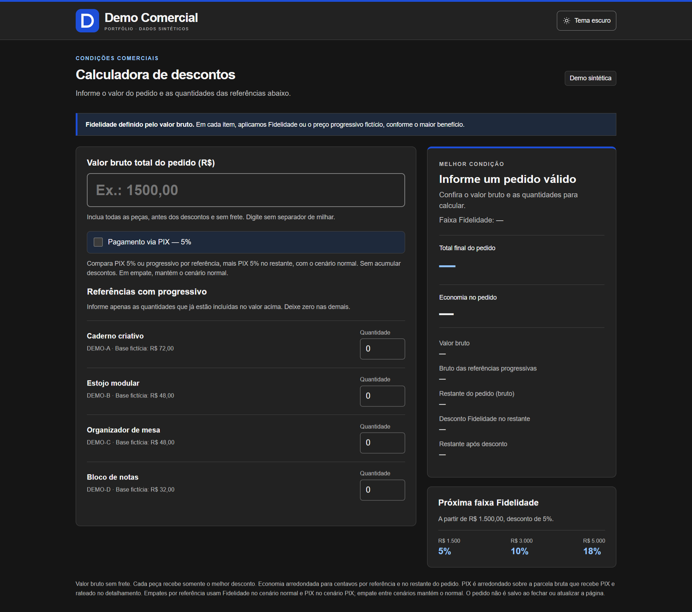

# Commercial Pricing Calculator

A static pricing simulator built to compare multiple commercial pricing scenarios and automatically apply the option with the highest customer savings.

The interesting part is not the interface itself. The core of the project is the pricing engine: it has to compare loyalty discounts, progressive pricing and a demonstrative PIX scenario without stacking discounts incorrectly or producing inconsistent totals.

All products, prices and commercial rules in this repository are synthetic.

<p>
  
  
  

<a href="https://github.com/leviroiz/calculadora-comercial-publica/actions/workflows/tests.yml">
  
</a>
</p>

---

## Context

The calculator represents a commercial scenario where different pricing rules may apply to the same order.

The public demo compares:

- loyalty discounts based on gross order value
- progressive pricing by product reference and quantity
- a demonstrative PIX discount
- the best available rule for each eligible reference
- savings and final totals for each scenario

The application then compares the resulting scenarios and keeps the one with the highest total savings.

> [!NOTE]
> The catalog, SKUs, values, discount tiers and payment conditions are synthetic and adapted for demonstration purposes.
>
> They do not represent real commercial policies or official payment rules.

---

## What made this tricky

### Rules can apply at different levels

The loyalty discount depends on the gross order value.

Progressive pricing, however, depends on the quantity of a specific product reference.

That means the calculator cannot simply choose one percentage and apply it to the whole order. Each eligible reference has to be evaluated independently, while the remaining order value follows the broader scenario rule.

### Discounts cannot be stacked

For a given product reference, the pricing engine compares the available benefits and applies only one.

In the normal scenario:

```text
Loyalty vs. Progressive
```

In the PIX scenario:

```text
PIX vs. Progressive
```

The same unit never receives two discounts simultaneously.

### Scenario comparison

The normal and PIX scenarios are calculated independently.

The calculator compares their total savings and only applies the PIX scenario when it produces a strictly greater benefit.

If both scenarios result in the same total savings, the normal scenario is preserved.

### Rounding matters

Monetary calculations are handled in cents.

PIX savings are rounded over the eligible gross value while preserving cumulative allocation across product references, avoiding inconsistent totals caused by rounding every line independently.

### Totals must remain consistent

Every scenario must preserve the relationship:

```text
gross total - savings = final total
```

The tests also verify that line totals plus the remaining order value match the scenario final total.

---

## Pricing model

The public demo uses the following synthetic catalog:

| SKU | Demo product | Base price | 4+ units | 8+ units |
|---|---|---:|---:|---:|
| DEMO-A | Creative Notebook | R$ 72.00 | R$ 66.00 | R$ 60.00 |
| DEMO-B | Modular Pencil Case | R$ 48.00 | R$ 45.00 | R$ 42.00 |
| DEMO-C | Desk Organizer | R$ 48.00 | R$ 45.00 | R$ 42.00 |
| DEMO-D | Notepad | R$ 32.00 | R$ 30.00 | R$ 28.00 |

Loyalty tiers:

| Gross order value | Discount |
|---|---:|
| Below R$ 1,500 | 0% |
| From R$ 1,500 | 5% |
| From R$ 3,000 | 10% |
| From R$ 5,000 | 18% |

The PIX scenario uses a demonstrative **5% discount**.

---

## Example

Consider:

```text
Gross order value: R$ 1,000.00
Quantity: 4 × DEMO-A
PIX comparison: enabled
```

For `DEMO-A`, progressive pricing reduces the unit price from:

```text
R$ 72.00 → R$ 66.00
```

producing:

```text
4 × R$ 6.00 = R$ 24.00
```

in savings.

The remaining order value is:

```text
R$ 1,000.00 - R$ 288.00 = R$ 712.00
```

The demonstrative 5% PIX discount on that remainder produces:

```text
R$ 35.60
```

Total PIX scenario savings:

```text
R$ 24.00 + R$ 35.60 = R$ 59.60
```

Final total:

```text
R$ 940.40
```

The normal scenario produces:

```text
Savings: R$ 24.00
Final total: R$ 976.00
```

For this example, the PIX scenario produces the greater savings.

---

## Architecture

The application is fully static and runs in the browser.

```text
User Input
    │
    ▼
app.js
    │
    ▼
calculator.js
    │
    ├── Input validation
    ├── Loyalty rules
    ├── Progressive pricing
    ├── PIX scenario
    ├── Scenario comparison
    └── Monetary rounding
    │
    ▼
Calculated Result
    │
    ▼
DOM Rendering
```

The main responsibilities are separated across:

```text
calculator.js   Pricing engine and calculation rules
rules.js        Synthetic catalog and pricing configuration
app.js          User input and DOM rendering
theme.js        Theme preference and persistence
```

The pricing engine does not depend on the DOM, which allows the business rules to be tested independently from the interface.

---

## Demo preview

<p align="center">
  
</p>

The interface displays both pricing scenarios, the applied rules, savings and final values.

It supports light and dark themes and runs entirely on the client side.

---

## Tests

The repository includes calculation, audit and browser-based UI tests.

Run the complete suite with:

```bash
npm install
npm test
```

The test command executes:

```text
tests/calculator.test.cjs
tests/audit.test.cjs
tests/ui.test.cjs
```

The calculation tests cover:

- loyalty tier boundaries
- progressive pricing
- PIX enabled and disabled
- invalid monetary inputs
- invalid quantities
- unknown product references
- tie-breaking rules

The audit suite independently calculates expected results across multiple combinations of:

- order values
- quantities
- PIX enabled or disabled

It verifies scenario savings, final totals and conservation of monetary values.

The Playwright suite validates the actual interface using Microsoft Edge, including:

- calculation results
- validation errors and recovery
- PIX interaction
- keyboard interaction
- theme persistence
- JavaScript runtime errors
- responsive behavior

The interface is checked at:

```text
1440px
390px
320px
```

in both light and dark themes.

---

## Privacy and data handling

The application has no backend.

It does not use:

- databases
- customer accounts
- commercial APIs
- analytics
- persistent order storage

Order information remains in browser memory and disappears when the page is reloaded.

The only persisted client-side value is the selected visual theme.

No real commercial data is included in the repository.

---

## Running locally

Because the project is static, `index.html` can be opened directly in a browser.

For the complete automated test environment:

```bash
npm install
npm test
```

---

## Docker

The repository also includes an Nginx-based Docker configuration:

```bash
docker compose up --build -d
```

The application is then exposed locally at:

```text
http://localhost:8081
```

To stop it:

```bash
docker compose down
```

> [!NOTE]
> The Docker configuration is included in the repository, but its execution is not currently claimed as validated in the documented test environment.

---

## Limits

This project demonstrates the pricing engine and interface architecture rather than a production commercial platform.

It does not include:

- real product catalogs
- official pricing policies
- real payment conditions
- backend validation
- authentication
- persistent orders
- production analytics
- commercial integrations

Automated tests run through GitHub Actions on pushes and pull requests to `main`, using Node.js 22 on Windows with Microsoft Edge for Playwright UI testing.

---

## License

Licensed under the [MIT License](LICENSE).
